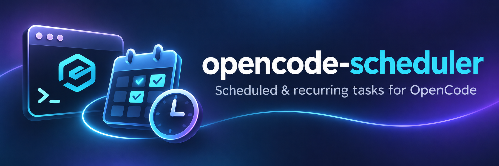

# opencode-scheduler



[](https://www.npmjs.com/package/@zebrajaeger/opencode-scheduler)
[](https://github.com/zebrajaeger/opencode-scheduler/actions/workflows/ci.yml)
[](LICENSE)
[](package.json)

[Deutsch](README.de.md) | [English](README.md)

Repository: [zebrajaeger/opencode-scheduler](https://github.com/zebrajaeger/opencode-scheduler) · [npm](https://www.npmjs.com/package/@zebrajaeger/opencode-scheduler) · [MIT](LICENSE)

<a id="deutsch"></a>
## Deutsch

### Orchestrierung: Entwicklungsvorschau

Die ereignisgesteuerte Erweiterung ist noch nicht vollständig implementiert. Die
bisherige Timer-Konfiguration und die fünf Timer-Werkzeuge bleiben unverändert.
Verfügbar sind die Prüfung optionaler Einstellungen und die Diagnose
`orchestration_status` sowie bei unterstütztem SQLite projektbezogene `session_find`,
`session_read` und passive `session_send`. `task_update` und `signal_emit` veröffentlichen
explizite Tasks/Ergebnisse und eigene Signale. `job_create`, `job_list` und `job_control`
registrieren und prüfen persistente Jobs. Automatische projektinterne Job-Zustellung und
aktive Queue-Prompts sind mit dauerhafter Orchestrierung freigeschaltet. Es bleibt eine
Entwicklungsvorschau: bisherige Host-Qualifikation Windows x64/OpenCode 2.4.2, keine
allgemeine Produktionszertifizierung.

**Abnahmeblocker:** Dauerhafte native Ausführungstrigger sind im qualifizierten
CLI-Host nicht verfügbar. OpenCode 2.4.2 speichert dort keine nativen Ereignispayloads;
`log.synced` allein belegt keine Replay-Abdeckung. Die Registrierung solcher Trigger
meldet `unsupported-capability`. Plugin-eigene Task-/Ergebnis-/Signal- und Zeitjobs
bleiben verfügbar; unklare Annahmegates bleiben nach Neustart ohne hinreichende
Belege gesperrt. Die verpflichtende native Replay-Abnahme ist **nicht abgeschlossen**.
Details: `docs/native-replay-blocker.md`.

Bei aktivierter Orchestrierung bleiben minimale Zustellungsdaten und die gemeinsame
Zielsperre bereits eingereichter Timer-Prompts bis zur sicheren Klärung über Reloads
erhalten. Timer-Definitionen verschwinden weiterhin; die Sicherheitsdaten stellen
keinen Timer wieder her. Ohne Orchestrierung bleibt das bisherige Unload-Verhalten.

Das optionale Plugin-Optionsobjekt `orchestration` unterstützt `enabled` (Standard false),
eine stabile `instanceID`, ein absolutes lokales `dataDirectory` sowie optional `sdk`,
`limits` und `retention`. Beispiel: `{"enabled":true,"instanceID":"local","dataDirectory":"C:/scheduler-data"}`.
Alle Locations desselben Datenverzeichnisses müssen dieselben Richtlinien verwenden.
`sdk` akzeptiert entweder eine HTTP-Loopback-`baseUrl` oder `discover: true`, dazu optional
`tokenEnv` als Namen einer Umgebungsvariable, niemals einen direkten geheimen Wert.
`orchestration_status` prüft konfigurierte SDK-Verbindungen bei Bedarf; nicht unterstützte
Endpunkte werden abgelehnt.

Grenzen lassen sich nur senken: 16 Bedingungen, 32 KiB JSON, 16 KiB Text, 64 KiB
Aktivierung, 100 Aufgaben/Eigentümer, 1000/Projekt, 100 Postfacheinträge, 8 kausale
Schritte, 20 Kettenaktivierungen und maximal sieben Tage Lebensdauer. Aufbewahrung:
standardmäßig sieben Tage und 10.000 nicht referenzierte Einträge. Ungültige Vorschau-
Einstellungen melden `invalid-input`, ohne alte Timer abzuschalten. Fehlendes SQLite
meldet `unsupported-runtime`; nicht unterstützte Historie/Replay müssen
`unsupported-capability` melden statt unzuverlässiger Live-Auswertung. Eine verfügbare
SQLite-Laufzeit bedeutet noch keine einsatzbereiten dauerhaften Werkzeuge.
Siehe [Laufzeitprüfung (Englisch)](docs/development.md).

Bei „dem Reviewer“ sucht der Agent zuerst nach Titel/Projekt und fragt bei Mehrdeutigkeit
nach. `session_read` kennzeichnet kompaktierten Kontext und bietet gespeicherte Tasks,
Ergebnisse und Postfachdaten; vollständige Historie erfordert eine verifizierte SDK-Verbindung
und meldet sonst `unsupported-capability`.
Passives `session_send` speichert eine Nachricht mit Herkunft, ohne den Empfänger zu
wecken oder eine Chat-Benachrichtigung anzuzeigen. Prompt-Modus speichert eine Outbox mit
fester ID und verwendet Queue-Zustellung. Unklare Annahmen bleiben bis zur Klärung gesperrt
und werden niemals blind erneut gesendet. Private Job-Definitionen werden nicht
offengelegt; Inhalte anderer Sessions bleiben nicht vertrauenswürdige Daten.

`task_update` erstellt produzenteneigene Tasks; Änderungen erfordern die erwartete
Revision. `completed` erst veröffentlichen, wenn relevante Subagenten-/Hintergrundarbeit
abgeschlossen ist. Das Ergebnis ist unveränderlich; spätere Idle-/Fehlerereignisse
ziehen es nicht zurück. Bei verlorener Antwort denselben Veröffentlichungsschlüssel
wiederholen. Korrekturen verwenden einen neuen Task/ein neues Ergebnis.
Für frühe kritische Funde `signal_emit` mit `review.critical-finding` und begrenzten
JSON-Daten verwenden, ohne das Review abzuschließen. Die Veröffentlichung allein
weckt nur dann einen anderen Agenten, wenn ein passender Job aktivierende Zustellung verlangt.

Job-Werkzeuge kehren sofort zurück, auch bei unfertigen Quellen oder beschäftigtem Ziel.
`job_list` zeigt eigene Revisionen, Job-Zustand und zugehörige Run-Diagnosen (`pending`,
`submitting`, `accepted`, `delivered`, `settled`, `uncertain` oder terminale Fehler).
`job_control` benötigt diese Revision; Abbruch stoppt künftige Annahmen, nicht akzeptierte Arbeit.
ALL benötigt jede festgelegte Quelle, ANY wählt einen deterministischen Treffer.
Fachlichen Abschluss über `scheduler.task.completed` mit Produzent und Task festlegen,
nicht über technisches Idle/Success. Zeitbedingungen verwenden absolute `dueAt` oder
nominelle `intervalSeconds`; Wiederholungen benötigen neue Ereignisse oder einen Zeittakt.
Für Status alle fünf Minuten bis Review-Abschluss: repeat-Modus, 300-Sekunden-Zeittakt
und eine an den Review-Task gebundene `until`-Signalgruppe. IDs ermittelt der Agent per
Suche; bei Mehrdeutigkeit fragt er nach. Registrierung meldet derzeit
`automaticDispatchEnabled`: Dauerhafte Registrierung/Annahme bedeutet noch keinen Ausführungserfolg.

Die fünf Zusammenarbeitswünsche verwenden Suche statt technischer IDs vom Benutzer:

- „Warte auf das Review und aktualisiere danach die Spezifikation“: Review-Sitzung
  suchen, veröffentlichten Task lesen und eine Ergebnisabhängigkeit registrieren.
- „Melde kritische Funde sofort“: Abhängigkeit vom Fundsignal registrieren; der
  Reviewer veröffentlicht den Fund, ohne seinen laufenden Review-Task abzuschließen.
- „Starte die Tests, sobald beide Implementierungen fertig sind“: beide Tasks suchen
  und ALL auf deren unveränderliche Abschlussergebnisse registrieren.
- „Melde alle fünf Minuten den Status, bis das Review fertig ist“: wiederholenden
  Zeitjob mit 300 Sekunden Intervall und Task-Abschluss als Stoppbedingung anlegen.
- „Fasse alle aktuellen Reviewer zusammen“: gemeinte Reviewer auflösen und deren
  Tasks bei Registrierung festhalten; spätere Reviewer werden nicht still ergänzt.

Der Agent fragt nur bei echter Mehrdeutigkeit oder fehlendem Abschlussvertrag nach.
Technischer Ausführungserfolg ist kein fachlicher Abschluss. Der
[Szenarioaudit (Englisch)](docs/orchestration-acceptance-audit.md) nennt geprüfte Abdeckung und Lücken.

Einmalige und wiederkehrende Prompts für OpenCode-Agenten – zeitlich begrenzt und immer in ihrer ursprünglichen Sitzung. Lass den Agenten später nach einem Container sehen oder regelmäßig einen Hintergrundtest prüfen, ohne die aktuelle Arbeit zu unterbrechen.

[Installation](#de-installation) · [Konfiguration](#de-konfiguration) · [Beispiele und Tools](#de-tools) · [Kompatibilität](#de-kompatibilitaet) · [Grenzen und Sicherheit](#de-grenzen) · [Entwicklung](#de-entwicklung)

<a id="de-installation"></a>
### Installation

Das Plugin ist öffentlich auf npm verfügbar. Trage es global in `~/.config/opencode/opencode.jsonc` oder projektbezogen in `opencode.jsonc` bzw. `.opencode/opencode.jsonc` ein:

```json
{
  "plugins": ["@zebrajaeger/opencode-scheduler"]
}
```

Für eine bestimmte veröffentlichte Version:

```json
{
  "plugins": ["@zebrajaeger/opencode-scheduler@0.1.3"]
}
```

OpenCode lädt das öffentliche Paket und seine Abhängigkeiten selbst herunter. Kein manuelles Klonen oder `npm install`, keine npm-Zugangsdaten erforderlich; Netzwerkzugriff bleibt nötig. Normale Konfigurationsfreigaben und Tool-Berechtigungen gelten weiterhin.

Konfiguriere das Plugin nur einmal pro effektivem Standort. Mische nicht mehrere Versionen, lokale Paketpfade und das npm-Paket derselben Plugin-Identität. Globale und projektbezogene Plugin-Arrays werden nach Priorität verarbeitet, nicht einfach gegenseitig ersetzt. Relative Pfade werden von der Konfigurationsdatei aus aufgelöst.

OpenChamber verwendet dasselbe OpenCode-Serverplugin; eine eigene Erweiterung oder ein Panel ist nicht nötig. Aktiviere es in der effektiven Konfiguration des verwendeten Servers. Starte keinen gemeinsam genutzten Dienst mit wichtiger laufender Arbeit nur für einen Installationstest neu.

<a id="de-konfiguration"></a>
### Konfiguration

Die optionalen Plugin-Standardwerte:

```json
{
  "plugins": [
    {
      "package": "@zebrajaeger/opencode-scheduler",
      "options": {
        "defaultMaxLifetimeSeconds": 3600,
        "minimumSpacingSeconds": 30
      }
    }
  ]
}
```

Zeitangaben sind ganze Sekunden. Standardmäßig endet ein Timer **eine Stunde nach seiner ursprünglichen Erstellung**, einschließlich Warte- und Ausführungszeit. Der Mindestabstand beträgt **30 Sekunden pro Sitzung über alle Timer hinweg** und kann erhöht, aber nicht unterschritten werden. Ein explizites `maxLifetimeSeconds` überschreibt den Standard.

<a id="de-tools"></a>
### Beispiele und Tools

Bitte den Agenten in normaler Sprache, beispielsweise:

- „Prüfe in zwei Minuten, ob der Container gestartet ist.“
- „Berichte alle fünf Minuten über den Teststatus, höchstens eine halbe Stunde lang.“
- „Liste meine aktiven Timer.“
- „Ändere das Prüfintervall auf zehn Minuten.“
- „Stoppe diesen Timer.“ / „Stoppe alle Timer in dieser Sitzung.“

Es sind keine zusätzlichen AGENTS.md-Anweisungen oder Slash-Befehle nötig. Der Server registriert fünf Tools:

| Tool | Aufgabe |
| --- | --- |
| `timer_start` | Timer mit `mode` (`once` oder `repeat`), `prompt`, optionalem `label` und Zeitangaben erstellen. |
| `timer_list` | Eigene aktive Timer auflisten; keine Argumente. |
| `timer_update` | Timer über `timerId` ändern: Prompt, Label, Zeitplan oder Laufzeit. |
| `timer_stop` | Eigenen Timer über die genaue `timerId` stoppen. |
| `timer_stop_all` | Alle Timer dieser Sitzung stoppen; keine Argumente. |

`once` benötigt `delaySeconds`. `repeat` benötigt `intervalSeconds`; ohne eigene Verzögerung startet der erste Lauf nach diesem Intervall. `maxLifetimeSeconds` begrenzt die Lebensdauer. Modus und Eigentümerschaft können nicht geändert werden. Bei einer mehrdeutigen Referenz soll der Agent zuerst die Timer auflisten.

Eine reine Intervalländerung verlängert die Laufzeit **nicht**. Auch eine explizite Laufzeitänderung bleibt auf die ursprüngliche Erstellung bezogen. Timer gehören zur Sitzung, zum Projekt und zum Standort ihres Aufrufs; andere Sitzungen können sie nicht einsehen oder ändern.

Die Tools liefern JSON mit `ok` und `result`, bei Fehlern `ok: false` und `error` mit stabilem `code` und begrenzter `message`. Die Liste zeigt Zeitplan, Ablauf, Status (`scheduled`, `deferred`, `in-flight` oder deaktiviert), angenommene Läufe und den letzten Fehler. Ein angenommener Lauf bedeutet nicht, dass die nachgelagerte Aufgabe erfolgreich abgeschlossen wurde.

<a id="de-kompatibilitaet"></a>
### Kompatibilität

- **OpenCode 2.3.2 und 2.4.1:** API-Verträge und isolierte reale Servertests auf Windows x64 verifiziert, auch mit dem veröffentlichten npm-Paket 0.1.1.
- **OpenCode Web/Server 2.4.1 und OpenChamber Web 2.8.0:** interaktive Smoke-Checks auf Windows x64 bestanden.
- **OpenCode V1, andere Versionen und andere Betriebssysteme:** nicht verifiziert.
- Deklarierte Node-Anforderung: **Node.js >=22**. Das Node-Badge zeigt den Paket-Enginebereich, keine vollständige Testmatrix.

[Verifikation (Englisch)](docs/verification.md) · [Release-Nachweise (Englisch)](docs/release-verification.md) · [Smoke-Test (Englisch)](docs/smoke-test.md)

<a id="de-grenzen"></a>
### Grenzen und Sicherheit

- **Fälligkeit ist keine garantierte Antwortzeit.** Aktive Agentenarbeit und Vordergrundtools verzögern Timer. Echte Hintergrundprozesse blockieren eine ansonsten inaktive Sitzung nicht, sobald ihr startendes Tool zurückgekehrt ist. Der Agent muss ihren tatsächlichen Status mit seinen normalen Tools prüfen; verstrichene Zeit allein ist kein Nachweis.
- Prompts gehen mit `delivery: "queue"` an die bestehende Sitzung. Verlauf, Agent, Modell, Berechtigungen und Arbeitskontext bleiben erhalten. Keine Ersatzsitzung, kein eigener LLM-Aufruf und keine Unterbrechung fremder Arbeit.
- Pro Sitzung ist höchstens eine Scheduler-Übergabe wartend oder in Ausführung. Die Sperre bleibt nach Annahme bis zur zugeordneten Zustellung und Beendigung bestehen. Nach jedem abgeschlossenen Check gilt der Mindestabstand; andere Sitzungen laufen unabhängig weiter.
- Wiederholungen haben feste Zeitfenster. Verpasste Intervalle werden zu einem Check zusammengefasst, nicht als Nachholserie abgespielt – auch nach langer Arbeit oder Standby. Der nächste Termin liegt in der Zukunft; abgelaufene Timer werden nicht neu gestartet.
- Übergabe- oder Ausführungsfehler deaktivieren den Timer statt Endlosschleifen auszulösen. Eine gültige explizite Änderung kann einen geklärten wiederkehrenden Timer reaktivieren. Unklare oder hängende Übergaben halten die Sitzungssperre konservativ; Stoppen und Neuanlegen umgehen sie nicht. Ein bereits eingereichter Einmal-Timer kann nicht neu aktiviert werden. Bei Ausfall des Event-Streams wird nicht auf Verdacht ausgeführt.
- **Nur im Arbeitsspeicher:** Unload, Reload, Serverneustart oder Prozessende verlieren alle Timer. Keine Wiederherstellungsdatei, Datenbank oder eigener Hintergrunddienst. Beenden räumt Timeouts, Abonnements und Registrierungen auf, ohne auf laufende Agentenarbeit zu warten.
- `session.execution.interrupted` stoppt alle Timer der unterbrochenen Sitzung. Eine normale Antwort oder der Wechsel zu einem anderen Chat tut das nicht. Nicht angezeigte Sitzungen können weiterlaufen. Löschen entfernt ihre Timer; beim Umzug in ein anderes Projekt/Worktree müssen sie am Ziel neu erstellt werden. Forks erben keine Timer.
- **Berechtigungen bleiben bestehen.** Ein geplanter Prompt kann an einer nötigen Tool-Freigabe warten. Das Plugin erteilt keine automatische Genehmigung; unbeaufsichtigte Planung garantiert keine unbeaufsichtigte Ausführung.
- **Bereits angenommenes OpenCode-Input lässt sich nicht zuverlässig zurückziehen.** Stop, Ablauf, Unterbrechung und Unload verhindern neue lokale Übergaben, aber ein bereits eingereichter Prompt kann trotzdem laufen, auch nach Reload. Das Plugin unterbricht nicht die ganze Sitzung, um einen Monitoring-Prompt zu entfernen.
- Eigentümerschaft und Serialisierung gelten innerhalb eines Servers und Plugin-Standorts. Getrennte Serverprozesse koordinieren ihre Timer nicht.

<a id="de-entwicklung"></a>
### Entwicklerdokumentation

Für die Entwicklung Node.js >=22 und npm verwenden:

```sh
npm ci
npm run typecheck
npm test
npm run build
npm pack --dry-run
```

Diese Befehle veröffentlichen nichts. Der Build erzeugt den ESM-Einstieg `dist/index.js` und Deklarationen. Für eine lokale Installation nach dem Build den absoluten **Paketordner**, nicht eine einzelne kompilierte Datei konfigurieren:

```json
{
  "plugins": ["C:/ws.inc/opencode-scheduler"]
}
```

Unbeobachtete lokale Abhängigkeiten können einen OpenCode-Neustart erfordern; dadurch gehen die In-Memory-Timer verloren. Verwende eine isolierte Testinstanz.

Architektur: Ein standortlokaler Scheduler hält Timer und eine Übergabesperre pro Sitzung. Ein nächster Deadline-Timeout mit begrenzten Acknowledgement-Watchdogs ersetzt eine asynchrone `setInterval`-Schleife. Ein dünner Host-Adapter liest den Sitzungszustand und verwendet die offizielle Session-API.

[Entwicklung und API-Nachweise (Englisch)](docs/development.md) · [Szenario-Audit (Englisch)](docs/scenario-audit.md) · [Release-Anleitung (Englisch)](docs/releasing.md)

Lizenz: [MIT](LICENSE). Diese Repository-README aktualisiert bereits veröffentlichte npm-Versionen nicht; dafür ist ein gesondert freigegebener neuer Release nötig.
