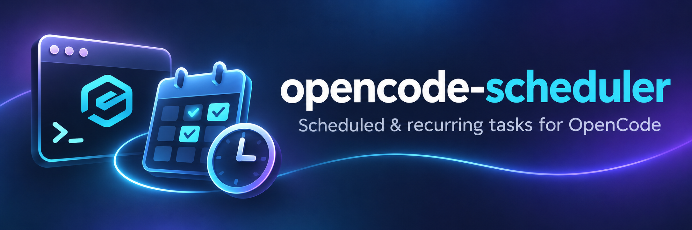

# opencode-scheduler



[](https://www.npmjs.com/package/@zebrajaeger/opencode-scheduler)
[](https://github.com/zebrajaeger/opencode-scheduler/actions/workflows/ci.yml)
[](LICENSE)
[](package.json)

[Deutsch](README.de.md) | [English](README.md)

Repository: [zebrajaeger/opencode-scheduler](https://github.com/zebrajaeger/opencode-scheduler) · [npm](https://www.npmjs.com/package/@zebrajaeger/opencode-scheduler) · [MIT](LICENSE)

<a id="english"></a>
## English

Bounded one-shot and recurring prompts for OpenCode agents, always in their original session. Ask your agent to check a container later or monitor a background test regularly without interrupting current work.

[Installation](#en-installation) · [Configuration](#en-configuration) · [Examples and tools](#en-tools) · [Compatibility](#en-compatibility) · [Limits and safety](#en-limits) · [Development](#en-development)

<a id="en-installation"></a>
### Installation

The package is public on npm. Enable it globally in `~/.config/opencode/opencode.jsonc`, or for a project in `opencode.jsonc` or `.opencode/opencode.jsonc`:

```json
{
  "plugins": ["@zebrajaeger/opencode-scheduler"]
}
```

For a specific published version:

```json
{
  "plugins": ["@zebrajaeger/opencode-scheduler@0.2.0"]
}
```

OpenCode retrieves the public package and its dependencies internally. No manual clone, `npm install` or npm credentials are required; network access remains necessary. Normal configuration trust and tool permissions still apply.

Configure the plugin once per effective location. Do not mix multiple versions, local package paths and the npm package for the same plugin identity. Global and project plugin arrays are processed in precedence order, not simply replaced. Relative paths resolve from the configuration file.

OpenChamber uses the same OpenCode server plugin; no separate extension or panel is needed. Enable it in the selected server's effective configuration. Do not restart a shared service with important active work just to test installation.

<a id="en-configuration"></a>
### Configuration

Optional plugin defaults:

```json
{
  "plugins": [
    {
      "package": "@zebrajaeger/opencode-scheduler",
      "options": {
        "defaultMaxLifetimeSeconds": 3600,
        "minimumSpacingSeconds": 30
      }
    }
  ]
}
```

All timing uses whole seconds. By default a timer ends **one hour after its original creation**, including waiting and execution time. Minimum spacing is **30 seconds per session across all timers**; it can be increased, never reduced below 30. Explicit `maxLifetimeSeconds` overrides the default.

<a id="en-tools"></a>
### Examples and tools

Ask the agent in ordinary language, for example:

- “Check in two minutes whether the container has started.”
- “Give me test status every five minutes, for at most half an hour.”
- “List my active timers.”
- “Change the status interval to ten minutes.”
- “Stop that timer.” / “Stop all timers in this session.”

No extra AGENTS.md instructions or slash commands are needed. Temporary monitoring uses these five tools:

| Tool | Purpose |
| --- | --- |
| `timer_start` | Create a timer with `mode` (`once` or `repeat`), `prompt`, optional `label` and timing arguments. |
| `timer_list` | List your active timers; no arguments. |
| `timer_update` | Update a timer by `timerId`: prompt, label, schedule or lifetime. |
| `timer_stop` | Stop an owned timer by its exact `timerId`. |
| `timer_stop_all` | Stop all timers in this session; no arguments. |

`once` requires `delaySeconds`. `repeat` requires `intervalSeconds`; the first delay defaults to that interval. `maxLifetimeSeconds` bounds lifetime. Mode and ownership cannot change. When a reference is ambiguous, the agent should list timers first.

Changing only the interval does **not** extend expiry. An explicit lifetime update also remains relative to original creation. Timers belong to the calling session, project and location; another session cannot inspect or modify them.

Tools return JSON with `ok` and `result`, or `ok: false` and `error` with a stable `code` and bounded `message`. Listed records show schedule, expiry, status (`scheduled`, `deferred`, `in-flight` or disabled), accepted run count and last error. An accepted run does not mean the downstream task completed successfully.

### Persistent automations

Version **0.2.0** adds durable routines alongside temporary timers and is published on npm. This feature is **not part of the already published 0.1.3 package**; use 0.2.0 or newer. See [release evidence](docs/automation-release.md).

> “Every weekday at 9 AM Europe/Berlin, check my assigned open pull requests and list their direct links. Use a new chat called ‘My Pull Requests’.”

> “Check deployment status every 30 minutes in the chat where the deployment is running.”

| | Temporary timer | Persistent automation |
| --- | --- | --- |
| Lifetime | Defaults to one hour | Until removed |
| Restart | Lost | Definition and pause state retained |
| Destination | Calling session only | Explicit existing/current chat, reusable new chat, or new chat every run |
| Stop current execution | Stops session timers | Keeps the saved routine |
| Missed while inactive | No restoration | Skip by default; explicit `catch-up-once` coalesces |

Automation tools: `automation_create`, `automation_list`, `automation_update`, `automation_pause`, `automation_resume`, `automation_remove`, and `automation_targets` for candidate chats. Any chat in the owning project/plugin location can manage its routines; cross-project/worktree destinations and separate-server coordination are not supported.

Creation requires `prompt`, `schedule`, and `target`. Interval schedules use `{ "kind": "interval", "intervalSeconds": 1800 }`. Calendar schedules use `{ "kind": "cron", "expression": "0 9 * * 1-5", "timeZone": "Europe/Berlin" }`: five numeric fields, with lists/ranges/steps; no seconds or cron extensions. Specify or clarify the IANA time zone. A nonexistent local time is skipped; a repeated local minute runs only at its first instance. Interval slots retain their original anchor; schedule edits reset it.

Target modes are `current` (“here”), `existing` with a resolved `sessionID`, `new-reuse` (“in a new chat”), and explicitly `new-each-run` (“a new chat every time”). Described destinations are resolved once; ambiguous matches require clarification. Renaming/navigation/forks do not redirect a bound target. Deleting or moving that target pauses the routine rather than silently replacing its chat. Retarget it and explicitly resume to repair it. Existing chats keep their context; new chats retain saved agent/model and permission restrictions, not the whole conversation.

Definitions are stored using official plugin storage, **without a separate service**. They run only while the OpenCode server **and the owning plugin location** are active; closing a UI window is not necessarily stopping its server. Default `missedPolicy: "skip"` waits for the next future occurrence after startup. Request `catch-up-once` explicitly to obtain one current-state check for missed occurrences. While a loaded runtime is busy or asleep, elapsed slots coalesce into one due check. Timers and automations share session serialization and minimum spacing.

Pause/remove prevent future admissions but cannot retract input already accepted by OpenCode. An execution failure pauses the routine. After a restart, an old handoff that cannot be proved terminal remains visibly `unresolved`, potentially indefinitely; neither idle state nor a message in history proves completion. Resume, retargeting, and removal do not bypass that barrier. Tool approvals and provider credentials remain necessary for unattended PR checks; the scheduler itself has no GitHub integration and never auto-approves tools.

<a id="en-compatibility"></a>
### Compatibility

- **OpenCode 2.3.2 and 2.4.1, Windows x64:** timer API/real-server tests passed, including public npm package 0.1.1. Persistent automations in 0.2.0 also passed SDK contracts and isolated restart/acceptance matrices on both pinned versions; they are not part of the published 0.1.3 package.
- **OpenCode Web/server 2.4.1 and OpenChamber Web 2.8.0, Windows x64:** timer interactive smoke checks and the separate A01–A12 automation fixture matrix passed. Fixture results do not certify arbitrary language interpretation or live PR-provider access; [automation UI evidence](docs/automation-ui-verification.md) records the bounds.
- **OpenCode V1, other versions and other operating systems:** unverified.
- Declared Node requirement: **Node.js >=22**. The Node badge shows the package engine range, not a complete test matrix.

[Verification](docs/verification.md) · [Release evidence](docs/release-verification.md) · [Smoke test](docs/smoke-test.md)

<a id="en-limits"></a>
### Limits and safety

- **A due time is not a guaranteed answer time.** Active agent work and foreground tools defer timers. Real background processes do not block an otherwise idle session once their initiating tool returns. The agent must inspect actual status with its normal tools; elapsed time alone is not evidence.
- Temporary timer prompts use `delivery: "queue"` in the existing session. History, agent, model, permissions and working context remain intact. No replacement session, plugin-owned LLM request or interruption of unrelated work. Automations use the same queued delivery in their explicitly selected target.
- At most one scheduler handoff is pending or executing per session. Its barrier survives acceptance until matching delivery and terminal execution evidence arrive. Each completed check starts the minimum cooldown; other sessions progress independently.
- Recurrence uses fixed nominal slots. Missed intervals coalesce into one check, not a catch-up burst, including after long work or sleep. The next slot is in the future; expired timers do not restart.
- Admission/execution errors disable the timer instead of looping. A valid explicit update can rearm a resolved recurring timer. Ambiguous or stalled admissions keep a conservative session barrier; stopping and recreating timers cannot bypass it. An already submitted one-shot cannot rearm. Event-stream failure blocks dispatch instead of guessing eligibility.
- **In-memory only (temporary timers):** unload, reload, server restart or exit loses all timers. Automation definitions/recovery use official persistent plugin storage; neither capability creates a separate background service. Cleanup clears timeouts, subscriptions and registrations without waiting for ongoing agent work.
- `session.execution.interrupted` stops all timers in the interrupted session. A normal answer or switching chats does not. Hidden sessions can continue. Deletion removes timers; moving to another project/worktree requires creating new ones at the destination. Forks do not inherit timers.
- **Permissions remain in force.** A scheduled prompt can wait for required tool approval. The plugin never auto-approves; unattended scheduling does not guarantee unattended execution.
- **Already accepted OpenCode input cannot reliably be retracted.** Stop, expiry, interruption and unload prevent new local admissions, but a submitted prompt can still run, including after reload. The plugin does not interrupt the whole session to remove a monitoring prompt.
- Ownership and serialization apply within one server and plugin location. Separate server processes do not coordinate their timers.

<a id="en-development"></a>
### Developer documentation

Use Node.js >=22 and npm for development:

```sh
npm ci
npm run typecheck
npm test
npm run build
npm pack --dry-run
```

These commands do not publish anything. The build produces the ESM entry `dist/index.js` and declarations. For a local installation after building, configure the absolute **package directory**, not a single compiled file:

```json
{
  "plugins": ["C:/ws.inc/opencode-scheduler"]
}
```

Unwatched local dependencies may require restarting OpenCode; this discards in-memory timers. Use an isolated test instance.

Architecture: a location-local scheduler holds timer records and one admission barrier per session. One next-deadline timeout with bounded acknowledgement watchdogs replaces an async `setInterval` loop. A thin host adapter reads session state and uses the official session API.

[Development and API evidence](docs/development.md) · [Scenario audit](docs/scenario-audit.md) · [Release guide](docs/releasing.md)

License: [MIT](LICENSE). These repository READMEs do not update existing immutable npm releases; a new separately authorized release is required for that.
